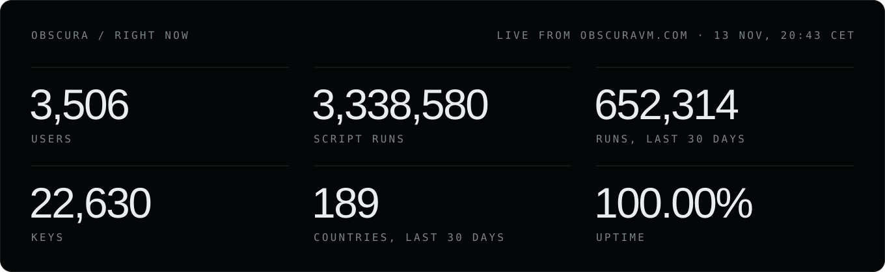
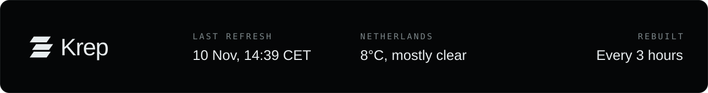

<!--
  Template for README.md: build.mjs fills in the {{…}} values every 3 hours and overwrites README.md,
  so edit this file, not README.md. The images theme themselves (light or dark with GitHub's theme).
  The static ones live on krepped.nl/github/; live.svg and footer.svg are drawn by build.mjs and sit in this repo.
-->

<!-- three tiles side by side: keep the <a> tags touching (no spaces or line breaks between them) -->

